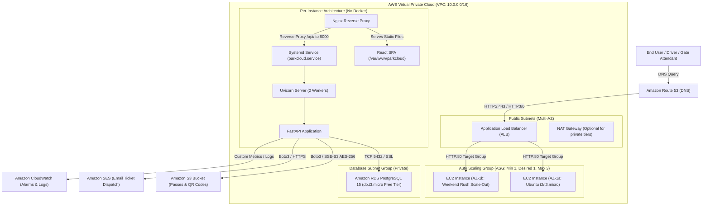

# AWS Infrastructure & Cloud DevOps Blueprint
## Project: ParkCloud (Cloud-Based Smart Parking Reservation System)
> Evaluated for **AWS Cloud & DevOps Engineering Standards**, High Availability, Least-Privilege Security, and Free Tier Optimization.

---

## 1. High-Availability Architectural Topology



---

## 2. EC2 Launch Template & Auto Scaling Group (ASG)

To absorb weekend traffic spikes without human intervention, ParkCloud utilizes an **AWS EC2 Launch Template** paired with a **Target Tracking Auto Scaling Group**.

### Launch Template Specifications
- **Template Name**: `parkcloud-launch-template-v1`
- **AMI**: Ubuntu Server 22.04 LTS (`ami-0c7217cdde317cfec` or current region equivalent)
- **Instance Type**: `t2.micro` or `t3.micro` (1 vCPU, 1 GB RAM - Free Tier eligible)
- **Key Pair**: `parkcloud-ec2-key`
- **IAM Instance Profile**: `ParkCloudEC2Role` (grants S3, SES & CloudWatch access)
- **Storage**: 20 GB gp3 SSD (encrypted)

### User Data Script (Automated Machine Bootstrapping)
Add the following script into the Launch Template **Advanced details > User data**:

```bash
#!/bin/bash
set -euo pipefail

# 1. Setup 2GB Swap Memory (Guarantees zero OOM on 1GB instances)
if [ ! -f /swapfile ]; then
    fallocate -l 2G /swapfile || dd if=/dev/zero of=/swapfile bs=1M count=2048
    chmod 600 /swapfile
    mkswap /swapfile
    swapon /swapfile
    echo '/swapfile none swap sw 0 0' >> /etc/fstab
fi

# 2. Update System & Install Native Runtimes
export DEBIAN_FRONTEND=noninteractive
apt-get update -y
apt-get install -y python3 python3-venv python3-pip nginx git curl libpq-dev postgresql-client build-essential

# 3. Clone Repository & Execute Automated Provisioning
cd /home/ubuntu
if [ ! -d "parkcloud" ]; then
    git clone https://github.com/your-org/parkcloud.git
fi
cd parkcloud
chmod +x scripts/setup_ec2.sh
bash scripts/setup_ec2.sh
```

### Auto Scaling Group (ASG) Configuration
- **Group Name**: `parkcloud-asg`
- **Subnets**: Subnet-1a, Subnet-1b, Subnet-1c (Multi-AZ resilience)
- **Capacity**:
  - Minimum: `1` (Always keeps cost within Free Tier 750 hrs/month)
  - Desired: `1`
  - Maximum: `3` (Allows scaling during Friday–Sunday peak rushes)
- **Target Tracking Scaling Policy**:
  - Metric type: `ASGAverageCPUUtilization`
  - Target value: `70%`
  - Warm-up period: `180 seconds`

---

## 3. Application Load Balancer (ALB) Setup

### Target Group
- **Target Group Name**: `parkcloud-tg`
- **Target Type**: Instances
- **Protocol / Port**: `HTTP` : `80`
- **Health Check**:
  - Path: `/api/health`
  - Protocol: `HTTP`
  - Healthy Threshold: `2`
  - Unhealthy Threshold: `3`
  - Timeout: `5 seconds`
  - Interval: `30 seconds`
  - Success Codes: `200`

### ALB Security Group (`parkcloud-alb-sg`)
| Type | Protocol | Port Range | Source | Description |
| :--- | :--- | :--- | :--- | :--- |
| Inbound | TCP | 80 | `0.0.0.0/0` | Public HTTP Access |
| Inbound | TCP | 443 | `0.0.0.0/0` | Public HTTPS Access |
| Outbound | TCP | 80 | `parkcloud-ec2-sg` | Traffic forwarded to EC2 instances |

### EC2 Security Group (`parkcloud-ec2-sg`)
| Type | Protocol | Port Range | Source | Description |
| :--- | :--- | :--- | :--- | :--- |
| Inbound | TCP | 22 | Administrator IP | Secure Bastion / SSH |
| Inbound | TCP | 80 | `parkcloud-alb-sg` | Traffic ONLY accepted from ALB |
| Outbound | All | All | `0.0.0.0/0` | Outbound Internet for S3/SES API calls |

---

## 4. S3 Bucket Policy (SSE-S3 Encryption & Public Block)

Bucket Name: `parkcloud-passes`

### Block Public Access Settings (S3 Console)
- **BlockPublicAcls**: `true`
- **IgnorePublicAcls**: `true`
- **BlockPublicPolicy**: `true`
- **RestrictPublicBuckets**: `true`

### Bucket Policy (`s3-bucket-policy.json`)
Enforces **TLS 1.2+ in-transit encryption** and **SSE-S3 AES-256 server-side encryption at rest**:

```json
{
  "Version": "2012-10-17",
  "Id": "ParkCloudS3SecurityPolicy",
  "Statement": [
    {
      "Sid": "EnforceTLSRequestsOnly",
      "Effect": "Deny",
      "Principal": "*",
      "Action": "s3:*",
      "Resource": [
        "arn:aws:s3:::parkcloud-passes",
        "arn:aws:s3:::parkcloud-passes/*"
      ],
      "Condition": {
        "Bool": {
          "aws:SecureTransport": "false"
        }
      }
    },
    {
      "Sid": "DenyUnencryptedObjectUploads",
      "Effect": "Deny",
      "Principal": "*",
      "Action": "s3:PutObject",
      "Resource": "arn:aws:s3:::parkcloud-passes/*",
      "Condition": {
        "StringNotEquals": {
          "s3:x-amz-server-side-encryption": "AES256"
        }
      }
    }
  ]
}
```

---

## 5. IAM Least-Privilege Security Policies

Attach these fine-grained IAM policies to the EC2 IAM Role (`ParkCloudEC2Role`).

### S3 Least-Privilege Policy (`ParkCloudS3PassPolicy`)
Allows storing, reading, and generating presigned URLs **only** within the `passes/` directory:

```json
{
  "Version": "2012-10-17",
  "Statement": [
    {
      "Sid": "AllowPassUploadAndRead",
      "Effect": "Allow",
      "Action": [
        "s3:PutObject",
        "s3:GetObject"
      ],
      "Resource": "arn:aws:s3:::parkcloud-passes/passes/*"
    },
    {
      "Sid": "AllowBucketListing",
      "Effect": "Allow",
      "Action": [
        "s3:ListBucket"
      ],
      "Resource": "arn:aws:s3:::parkcloud-passes"
    }
  ]
}
```

### SES Least-Privilege Email Policy (`ParkCloudSESPolicy`)
Restricts email dispatch strictly to verified sender identity:

```json
{
  "Version": "2012-10-17",
  "Statement": [
    {
      "Sid": "AllowEmailTicketDispatch",
      "Effect": "Allow",
      "Action": [
        "ses:SendEmail",
        "ses:SendRawEmail"
      ],
      "Resource": "*",
      "Condition": {
        "StringEquals": {
          "ses:FromAddress": "noreply@parkcloud.app"
        }
      }
    }
  ]
}
```

---

## 6. AWS CloudWatch Metrics & Alarm Configuration

### Alarm 1: API 5xx Error Rate Spike
- **Metric**: `AWS/ApplicationELB` -> `HTTPCode_Target_5XX_Count`
- **Threshold**: `> 5` errors in a 1-minute period
- **Evaluation Periods**: 1
- **Action**: Publish notification to Amazon SNS Topic `arn:aws:sns:us-east-1:123456789012:ParkCloudDevOpsAlerts`

```bash
aws cloudwatch put-metric-alarm \
    --alarm-name "ParkCloud-High-5XX-Error-Spike" \
    --alarm-description "Triggers when API 5xx errors exceed 5 in 1 minute" \
    --metric-name HTTPCode_Target_5XX_Count \
    --namespace AWS/ApplicationELB \
    --statistic Sum \
    --period 60 \
    --threshold 5 \
    --comparison-operator GreaterThanThreshold \
    --dimensions Name=TargetGroup,Value=targetgroup/parkcloud-tg/1234567890abcdef \
    --evaluation-periods 1 \
    --alarm-actions arn:aws:sns:us-east-1:123456789012:ParkCloudDevOpsAlerts
```

### Alarm 2: Parking Lot Capacity Warning (>90% Full Alert)
- **Metric**: `ParkCloud/Metrics` -> `LotOccupancyRate`
- **Threshold**: `>= 90%`
- **Period**: 300 seconds (5 minutes)
- **Action**: Alert parking operators to trigger overflow redirects

```bash
aws cloudwatch put-metric-alarm \
    --alarm-name "ParkCloud-Lot-Capacity-Exceeded-90Percent" \
    --alarm-description "Alerts operators when any facility reaches 90% full capacity" \
    --metric-name LotOccupancyRate \
    --namespace ParkCloud/Metrics \
    --statistic Maximum \
    --period 300 \
    --threshold 90 \
    --comparison-operator GreaterThanOrEqualToThreshold \
    --evaluation-periods 1 \
    --alarm-actions arn:aws:sns:us-east-1:123456789012:ParkCloudOpsTeam
```
